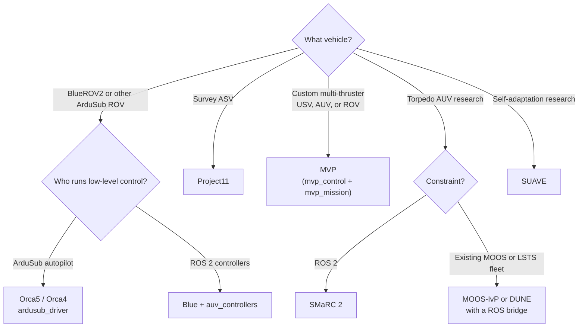

# Autonomy frameworks

An autonomy framework connects sensing, state estimation, planning, control, and mission execution, so that a vehicle can do a task with little or no operator input. This page lists the open frameworks that the maritime community uses, ROS-based and not.

## Which framework fits?

This is a starting point, not a rule. Most groups combine parts: for example robot_localization for state estimation, a framework's controllers, and their own mission layer.

## ROS-based frameworks

<!-- catalog:table names="Blue|Project11|CAMP|MVP (Marine Vehicle Packages)|Orca4|Orca5|SMaRC 2|SUAVE|COLA2" -->

### Comparison

| | Blue | Project11 | MVP | Orca4 / Orca5 | SMaRC 2 |
|---|---|---|---|---|---|
| Main vehicle | BlueROV2, UUVs | Survey ASVs | USV, AUV, ROV | BlueROV2 | SAM, LoLo AUVs |
| ROS 2 target | Rolling (humble, jazzy branches) | Jazzy | Jazzy (jazzy-devel) | Jazzy (Orca5) | Humble (jazzy WIP) |
| Low-level control | ROS 2 (auv_controllers) | ROS 2 | ROS 2 (QP allocation) | ArduSub autopilot | ROS 2 |
| Simulation | Gazebo | Project11 simulation packages | Stonefish | Gazebo Harmonic + ArduSub SITL | Unity |
| Good for | Research on control and autonomy for UUVs | Survey operations and multi-domain fleets | Custom thruster layouts | Getting a BlueROV2 autonomous quickly | Torpedo AUV research |

Values come from each project's README and default branch in October 2026. Check the repository before you commit to one.

## Non-ROS autonomy suites

Many fielded marine vehicles run autonomy outside ROS. You will meet these systems in collaborations, and you can bridge them to ROS.

<!-- catalog:table names="MOOS-IvP|DUNE|Goby3|Neptus" -->

!!! info "Bridging to ROS"

    - **MOOS-IvP**: no widely maintained public ROS 2 bridge exists. Most teams write a small gateway node that maps a few MOOS variables to ROS topics.
    - **LSTS (DUNE, Neptus, IMC)**: [imc_ros_bridge](https://github.com/smarc-project/imc_ros_bridge) (ROS 1) lets Neptus command a ROS vehicle.
    - **Goby3**: designed for slow intervehicle links, with MOOS interoperability. See [Communication](communication.md).

## Building blocks inside the frameworks

| Layer | Common choices | Page |
|---|---|---|
| Mission and behaviors | mvp_mission, Nav2 behavior trees, MOOS-IvP helm, custom state machines | [Control](control.md) |
| Guidance | Line-of-sight path following, waypoint controllers, Nav2 controllers on ASVs | [Control](control.md) |
| Control and allocation | auv_controllers, mvp_control, thruster_manager, ArduSub | [Control](control.md) |
| State estimation | robot_localization, fuse | [Localization](navigation.md) |
| Vehicle interface | mavros, ardusub_driver, ros2_control hardware interfaces | [Drivers](drivers.md) |
| Operator interface | QGroundControl, CAMP, Neptus, RViz, Lichtblick | [Tools](tools.md) |

## Learning projects

- [REMARO underwater robotics hackathon (TU Delft, 2022)](https://github.com/remaro-network/tudelft_hackathon): hands-on exercises with ROS 2 and Gazebo, default branch ros2.
- [TurtleBoat](https://github.com/bartboogmans/TurtleBoat): a turtlesim-like node with vessel dynamics, for first experiments with ship control.
