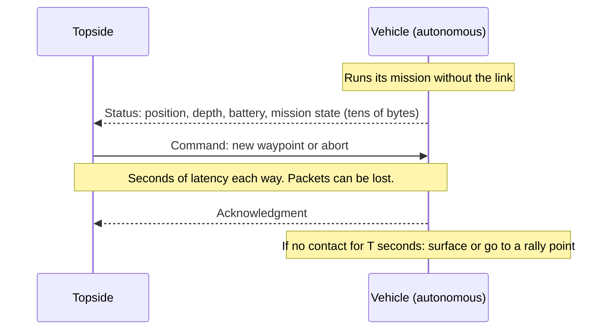

# Communication

A marine robot often has several links with very different bandwidth and latency. Design the software for the worst link the vehicle will use, and make sure the vehicle stays safe when every link fails.

## Links compared

| Link | Typical medium | Data rate | Latency | Range | Notes |
|---|---|---|---|---|---|
| Tether | Copper or fiber | Mb/s to Gb/s | Milliseconds | Tether length | Normal ROS 2 networking works |
| Wi-Fi and RF radios | Air | Mb/s (Wi-Fi) to kb/s (long-range radio) | Milliseconds | Line of sight, hundreds of meters to kilometers | Only at the surface; DDS discovery can flood slow radios |
| Cellular | Air | Mb/s | Tens of milliseconds | Near the coast | Coverage varies; plan for gaps |
| Satellite | Air | From short messages (Iridium SBD, a few hundred bytes per message) to broadband | Seconds (SBD) to tens of milliseconds | Global | Cost per byte matters for SBD |
| Acoustic modem | Water | Tens of bit/s to tens of kbit/s | Seconds (sound travels about 1500 m/s) | Hundreds of meters to kilometers | Shared, half-duplex, lossy, and affected by the environment |
| Optical modem | Water | Up to Mb/s | Milliseconds | Meters to tens of meters, clear water only | Needs pointing and clear water |

Water absorbs radio waves within centimeters to meters, so **sound is the only practical long-range link underwater**.

## Packages

<!-- catalog:table category=comms -->

## ros_acomms

[ros_acomms](https://acomms.pages.whoi.edu/ros_acomms/overview.html) from the WHOI Acoustic Communications Group carries ROS messages over acoustic links and Iridium. It provides:

- compact encoding of ROS messages into packets, with configurable field codecs (configured per message type, or by introspection)
- a priority queue manager that decides what to send in each slot
- media access control (MAC) to share the channel between vehicles
- modem drivers, with the WHOI Micro-Modem as the main target
- a link simulator with a ray-tracing channel model, so that you can test without water

The released versions target ROS 1. A merge request on the WHOI GitLab adds ROS 2 (Humble and Jazzy) support; check the documentation for its release status before you plan around it.

Reference: E. Gallimore, T. Schneider, H. Schmidt, "ROS Message Transport over Underwater Acoustic Links with ros_acomms," IEEE/OES AUV Symposium 2022.

## Designing for acoustic links

1. **Make the vehicle autonomous.** The link is for monitoring and high-level redirection, not for control loops or teleoperation.
2. **Send only what matters.** Status (position, depth, battery, mission state), waypoint updates, and abort commands. Not video, maps, or full-rate sensor data.
3. **Encode compactly.** Use fixed-point fields with the resolution you need (for example DCCL), not raw ROS serialization.
4. **Prioritize.** Safety commands first, then mission updates, then diagnostics.
5. **Expect loss.** Use acknowledgments and retries for commands, and time-stamp commands so the vehicle can ignore stale ones.
6. **Program autonomous failsafes.** Time-based and location-based surfacing, and an abort that does not depend on the link.
7. **Test in the real environment.** Range and reliability change a lot with depth, temperature profile, sea state, multipath near the surface and seafloor, and noise from shipping and snapping shrimp.

??? info "Why acoustic links behave the way they do"

    - **Low bandwidth**: the usable acoustic band is narrow (kilohertz to tens of kilohertz), and absorption grows with frequency. Longer range means lower frequency and lower rate.
    - **High latency**: sound travels at about 1500 m/s, so 3 km is 2 seconds one way, before any processing.
    - **Multipath**: reflections from the surface and seafloor arrive late and interfere, worst in shallow water.
    - **Refraction**: sound speed changes with temperature, salinity, and depth, which bends the paths and can create shadow zones.
    - **Doppler**: vehicle motion shifts frequencies and needs compensation.
    - **Half duplex and shared**: one modem talks at a time on a channel, so multi-vehicle systems need a MAC scheme (for example TDMA).

## Robot-to-shore networking with ROS 2

- **Separate the vehicle and shore domains.** Run the vehicle on its own `ROS_DOMAIN_ID`, and limit discovery with `ROS_AUTOMATIC_DISCOVERY_RANGE` so that robots on the same network do not see each other by accident.
- **Bridge only selected topics** over slow or intermittent radio links. Options: [rmw_zenoh](https://github.com/ros2/rmw_zenoh) (ROS 2 middleware on Zenoh, designed for wireless and intermittent links), [rosbridge_suite](https://github.com/RobotWebTools/rosbridge_suite) or [foxglove_bridge](https://github.com/foxglove/ros-foxglove-bridge) for web tools, or a small custom bridge.
- **Use QoS deliberately.** Best effort for telemetry, reliable for commands, and transient local for mission state that a reconnecting operator station needs.
- **MAVLink** is a compact alternative for telemetry on autopilot-based vehicles; QGroundControl and mavros speak it.

## Simulation of acoustic networks

- The ros_acomms link simulator models the channel for ROS testing.
- [ns-3 UAN](https://www.nsnam.org/docs/models/html/uan.html) simulates underwater acoustic networks for protocol research; it is not a vehicle simulator.
