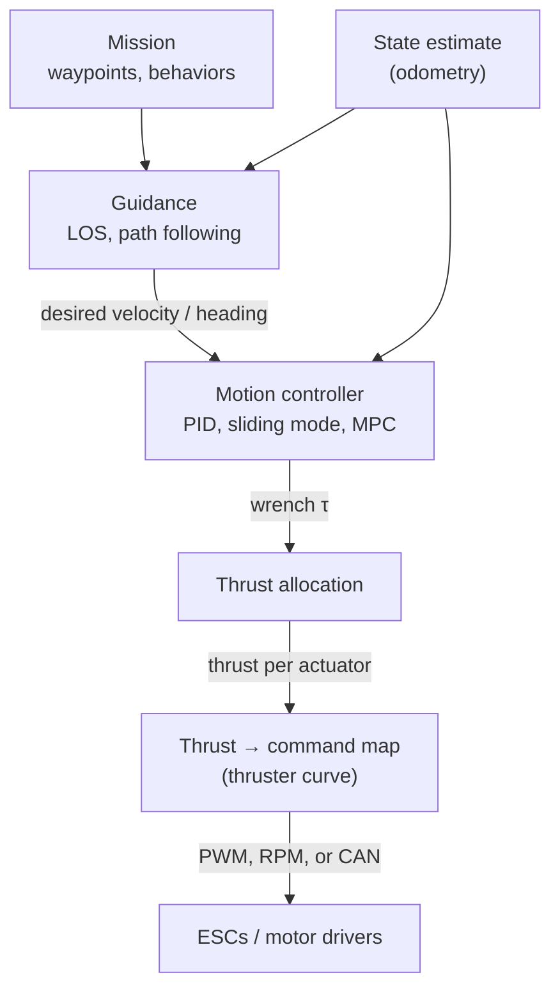

# Control and allocation

Marine vehicles are usually controlled in a cascade: guidance makes a desired velocity or pose, a controller turns it into a desired force and moment (a *wrench*), and thrust allocation distributes the wrench over the actuators.



Typical ROS 2 messages along the chain: `nav_msgs/Path` or waypoints → `geometry_msgs/Twist` → `geometry_msgs/Wrench` → per-thruster `std_msgs/Float64` or a ros2_control command interface.

## Packages

<!-- catalog:table category=control -->

## Thrust allocation

Given a desired wrench \( \tau \) (forces and moments in the body frame) and thrust vector \( f \) for \( n \) thrusters, the allocation matrix \( T \) maps thrust to wrench:

\[
\tau = T(\alpha)\, f, \qquad T \in \mathbb{R}^{6 \times n}
\]

Column \( i \) of \( T \) is \( [\,d_i ;\; r_i \times d_i\,] \), where \( d_i \) is the unit thrust direction and \( r_i \) the thruster position relative to `base_link`. For azimuth thrusters, \( T \) also depends on the angles \( \alpha \). Read the positions and directions from the URDF so that the controller and the simulation use the same geometry (thruster_manager does this).

### Methods

| Method | Handles thrust limits | Azimuth thrusters | Cost | Use when |
|---|---|---|---|---|
| Pseudo-inverse \( f = T^{+}\tau \) | No | No (fixed angles) | One matrix product | Fixed thrusters, and demands stay well inside the limits |
| Weighted pseudo-inverse | No, but can favor some thrusters | No | One matrix product | Some thrusters are weaker, less efficient, or noisier |
| Pseudo-inverse + uniform scaling | Keeps wrench direction, shrinks magnitude | No | Cheap | Simple vehicles that saturate sometimes |
| Quadratic programming (QP) | Yes: hard limits, rate limits, forbidden zones | Yes | Solver per cycle | Real vehicles that saturate, azimuth thrusters, prioritized axes |

The pseudo-inverse is valid for non-square \( T \) (more thrusters than controlled axes): it gives the minimum-norm thrust. Its problem is that it ignores limits, not that \( T \) is non-square.

### Tested example

A vectored layout with four horizontal thrusters, controlling surge, sway, and yaw:

```python title="allocation_example.py (output below is real)"
import numpy as np

# Thruster x, y (m, FLU body frame) and thrust direction angle (rad, from +x, CCW)
thrusters = np.array([
    [ 0.15,  0.11, np.deg2rad(-45)],   # front left
    [ 0.15, -0.11, np.deg2rad( 45)],   # front right
    [-0.15,  0.11, np.deg2rad(-135)],  # rear left
    [-0.15, -0.11, np.deg2rad( 135)],  # rear right
])
x, y, a = thrusters.T

# Rows: surge force, sway force, yaw moment (z component of r x d)
T = np.vstack([np.cos(a), np.sin(a), x * np.sin(a) - y * np.cos(a)])
T_pinv = np.linalg.pinv(T)

tau = np.array([30.0, 0.0, 3.0])       # 30 N forward, 3 N*m yaw
f = T_pinv @ tau                        # [  6.53  14.69  -6.53 -14.69]

f_max = 10.0                            # thruster limit (N)
f_clip = np.clip(f, -f_max, f_max)      # wrench -> [23.4, 0, 1.28]  direction changes
f_scaled = f * min(1.0, f_max / np.abs(f).max())  # wrench -> [20.4, 0, 2.04]  direction kept
```

Clipping each thruster on its own changes the *ratio* between surge and yaw (here from 10:1 to 18:1), so the vehicle turns less than commanded. Scaling keeps the ratio. A QP allocator can do better: for example, it can keep yaw and give up some surge.

### Known issues

??? warning "Pseudo-inverse allocators (thruster_manager, thruster allocation matrix controllers)"

    - **Saturation is not handled.** Commands beyond the thruster limits are clipped downstream, which changes the wrench direction (see the example). Use uniform scaling or a QP allocator.
    - **Ill-conditioned layouts.** If thrusters are nearly parallel, \( T \) is close to singular and small wrench changes give large thrust changes. Check `np.linalg.cond(T)` at design time.
    - **Dead zones.** Many thrusters give no thrust below a minimum command. Small demands then do nothing, which can cause limit cycles in station keeping. Compensate in the thrust-to-command map.

??? warning "QP allocators (mvp_control and others)"

    - **Solve time varies.** Monitor the solve time; reduce the problem size or the control rate if it causes jitter.
    - **More parameters.** Weights and constraints need tuning. Start with equal weights and add constraints one at a time.

??? warning "All allocators"

    - **The thruster curve matters as much as the allocation.** Thrust is roughly proportional to RPM squared and is asymmetric forward and reverse. Use the manufacturer's thrust curve at your supply voltage, or measure it on a test stand.
    - **Thrust falls with battery voltage.** Compensate, or retune when the battery type changes.
    - **Thruster interaction.** Thrusters close to each other or to the hull lose thrust. Field results are often lower than test-stand results.

## Motion control

### Station keeping (dynamic positioning)

Holds position and heading for inspection, sampling, or intervention. Common approaches:

- **PID per axis with feed-forward** of buoyancy and known currents. Simple and effective for small ROVs. Use anti-windup, because thrusters saturate.
- **Sliding mode control**, robust to model uncertainty and common in the marine control literature.
- **Impedance and whole-body control** for vehicles with manipulators; auv_controllers includes both, together with twist and trajectory controllers.
- **Model predictive control (MPC)** handles constraints explicitly but needs a model and more compute.

### Path following and guidance

**Line-of-sight (LOS) guidance** is the classic marine method. For a straight path segment with path angle \( \pi_p \) and cross-track error \( e \), the desired course is

\[
\chi_d = \pi_p - \arctan\!\left(\frac{e}{\Delta}\right)
\]

where the lookahead distance \( \Delta \) sets how fast the vehicle converges: a smaller \( \Delta \) converges faster but can oscillate. In a current, add integral action (integral LOS) or estimate the crab angle, because heading and course differ. The sign depends on how you define \( e \); keep it consistent with your frame convention.

Other options: pure pursuit, vector field guidance, and Nav2 controllers on surface vehicles (for example Regulated Pure Pursuit), with the vehicle modeled as differential drive.

### Underactuated vehicles

Torpedo AUVs and most ASVs cannot push sideways. Control surge speed, heading or course, and depth or pitch, and let guidance handle the path. Do not command sway velocity to an underactuated vehicle.

## Low-level integration

| Approach | How | Good for |
|---|---|---|
| ros2_control | Hardware interface plugin that writes thruster commands; controllers such as auv_controllers run in the controller manager | Clean real-time separation, standard tooling |
| Autopilot | ArduSub, ArduPilot Rover, or PX4 runs stabilization; ROS sends setpoints through mavros or DDS | Fast start on BlueROV2 or BlueBoat, built-in failsafes |
| Direct node | A node converts thrust to PWM through a PWM board (for example PCA9685) or a CAN bus | Small custom vehicles |

!!! danger "Keep a hardware failsafe"

    Whatever the stack, make sure that the thrusters stop when commands stop: use a command timeout in the driver or ESC, and a kill switch the operator can reach. Software watchdogs are not a substitute for a physical cut-off on a vehicle with exposed propellers.

## Further reading

- T. I. Fossen, *Handbook of Marine Craft Hydrodynamics and Motion Control*, 2nd ed., Wiley, 2021. The standard reference for marine vehicle models, guidance, and control.
- T. A. Johansen and T. I. Fossen, "Control allocation: A survey," *Automatica*, 49(5), 2013.
- [ros2_control documentation](https://control.ros.org/)
