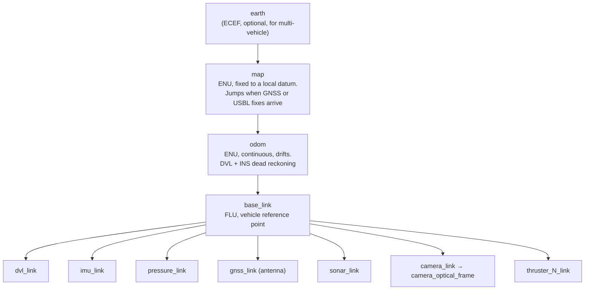

# Frames and conventions

Frame and sign errors cause more lost days in marine robotics than any algorithm. ROS uses one set of conventions, and marine instruments, textbooks, and autopilots often use another. This page gives the rules, the conversions, and a tested code example.

## The two conventions

<figure class="mrl-figure">
<svg viewBox="0 0 760 300" role="img" aria-labelledby="frames-title frames-desc">
  <title id="frames-title">ROS ENU and FLU frames compared with marine NED and FRD frames</title>
  <desc id="frames-desc">On the left, the ROS convention: world x east, y north, z up, and body x forward, y left, z up. On the right, the marine convention: world x north, y east, z down, and body x forward, y right, z down.</desc>
  <defs>
    <marker id="ah-x" viewBox="0 0 10 10" refX="8" refY="5" markerWidth="7" markerHeight="7" orient="auto-start-reverse"><path d="M0 0L10 5L0 10z" fill="#d9534f"/></marker>
    <marker id="ah-y" viewBox="0 0 10 10" refX="8" refY="5" markerWidth="7" markerHeight="7" orient="auto-start-reverse"><path d="M0 0L10 5L0 10z" fill="#2e9e5b"/></marker>
    <marker id="ah-z" viewBox="0 0 10 10" refX="8" refY="5" markerWidth="7" markerHeight="7" orient="auto-start-reverse"><path d="M0 0L10 5L0 10z" fill="#2f7bd6"/></marker>
  </defs>
  <text x="190" y="26" text-anchor="middle" class="mrl-svg-text" font-size="17" font-weight="700">ROS (REP 103)</text>
  <text x="570" y="26" text-anchor="middle" class="mrl-svg-text" font-size="17" font-weight="700">Marine / aerospace</text>
  <line x1="380" y1="40" x2="380" y2="285" class="mrl-svg-line" stroke-dasharray="4 5"/>

  <!-- ROS world ENU -->
  <text x="95" y="60" text-anchor="middle" class="mrl-svg-muted" font-size="13">World: ENU</text>
  <g stroke-width="3">
    <line x1="60" y1="200" x2="150" y2="200" class="mrl-svg-x" marker-end="url(#ah-x)"/>
    <line x1="60" y1="200" x2="110" y2="150" class="mrl-svg-y" marker-end="url(#ah-y)"/>
    <line x1="60" y1="200" x2="60" y2="95" class="mrl-svg-z" marker-end="url(#ah-z)"/>
  </g>
  <text x="156" y="205" class="mrl-svg-text" font-size="13">x East</text>
  <text x="114" y="146" class="mrl-svg-text" font-size="13">y North</text>
  <text x="66" y="95" class="mrl-svg-text" font-size="13">z Up</text>

  <!-- ROS body FLU -->
  <text x="280" y="60" text-anchor="middle" class="mrl-svg-muted" font-size="13">Body: FLU</text>
  <path d="M215 205 h95 q22 0 22 -12 q0 -12 -22 -12 h-95 z" class="mrl-svg-hull" opacity="0.9"/>
  <g stroke-width="3">
    <line x1="260" y1="193" x2="350" y2="193" class="mrl-svg-x" marker-end="url(#ah-x)"/>
    <line x1="260" y1="193" x2="300" y2="153" class="mrl-svg-y" marker-end="url(#ah-y)"/>
    <line x1="260" y1="193" x2="260" y2="100" class="mrl-svg-z" marker-end="url(#ah-z)"/>
  </g>
  <text x="300" y="216" class="mrl-svg-text" font-size="13">x Forward</text>
  <text x="304" y="150" class="mrl-svg-text" font-size="13">y Left</text>
  <text x="266" y="100" class="mrl-svg-text" font-size="13">z Up</text>

  <!-- Marine world NED -->
  <text x="475" y="60" text-anchor="middle" class="mrl-svg-muted" font-size="13">World: NED</text>
  <g stroke-width="3">
    <line x1="440" y1="130" x2="490" y2="80" class="mrl-svg-x" marker-end="url(#ah-x)"/>
    <line x1="440" y1="130" x2="530" y2="130" class="mrl-svg-y" marker-end="url(#ah-y)"/>
    <line x1="440" y1="130" x2="440" y2="235" class="mrl-svg-z" marker-end="url(#ah-z)"/>
  </g>
  <text x="494" y="80" class="mrl-svg-text" font-size="13">x North</text>
  <text x="536" y="135" class="mrl-svg-text" font-size="13">y East</text>
  <text x="446" y="250" class="mrl-svg-text" font-size="13">z Down</text>

  <!-- Marine body FRD -->
  <text x="665" y="60" text-anchor="middle" class="mrl-svg-muted" font-size="13">Body: FRD</text>
  <path d="M595 142 h95 q22 0 22 -12 q0 -12 -22 -12 h-95 z" class="mrl-svg-hull" opacity="0.9"/>
  <g stroke-width="3">
    <line x1="640" y1="130" x2="730" y2="130" class="mrl-svg-x" marker-end="url(#ah-x)"/>
    <line x1="640" y1="130" x2="600" y2="170" class="mrl-svg-y" marker-end="url(#ah-y)"/>
    <line x1="640" y1="130" x2="640" y2="235" class="mrl-svg-z" marker-end="url(#ah-z)"/>
  </g>
  <text x="682" y="112" class="mrl-svg-text" font-size="13">x Forward</text>
  <text x="560" y="186" class="mrl-svg-text" font-size="13">y Right</text>
  <text x="646" y="250" class="mrl-svg-text" font-size="13">z Down</text>

  <text x="190" y="280" text-anchor="middle" class="mrl-svg-muted" font-size="12">Yaw positive counter-clockwise from East</text>
  <text x="570" y="280" text-anchor="middle" class="mrl-svg-muted" font-size="12">Heading positive clockwise from North</text>
</svg>
<figcaption>Red is x, green is y, blue is z. All four frames are right-handed.</figcaption>
</figure>

| | ROS convention | Marine and aerospace convention |
|---|---|---|
| Defined by | [REP 103](https://www.ros.org/reps/rep-0103.html) | SNAME (1950), Fossen, most INS and DVL vendors, ArduPilot and PX4 internally |
| World frame | ENU: x east, y north, z up | NED: x north, y east, z down |
| Body frame | FLU: x forward, y left, z up | FRD: x forward, y right, z down |
| Heading / yaw | Yaw, counter-clockwise from east | Heading, clockwise from north (compass) |
| Vertical | z up; altitude positive | z down; depth positive |

**Rule: inside ROS, publish ENU world data and FLU body data.** Convert at the edge of your system, in the driver or the bridge, and say so in the package README. Some packages also publish NED and FRD companion frames for interoperability (for example mavros), but the main tree stays ENU and FLU.

## The frame tree on a vessel (REP 105)

[REP 105](https://www.ros.org/reps/rep-0105.html) defines the mobile platform frames. On a marine vehicle:



- **map → odom** comes from the global estimator (for example a second robot_localization instance with GNSS or USBL). It may jump.
- **odom → base_link** comes from the local estimator and must be continuous. Underwater, this is DVL, INS, and depth fusion.
- **base_link → sensors** are static transforms from the URDF. Measure lever arms carefully: a 10 cm DVL offset combined with a 30°/s yaw rate gives about 5 cm/s of false lateral velocity if you ignore it.
- Choose one documented reference point for `base_link`, for example the center of gravity or the hull reference point that the survey offsets use.
- Camera images use an optical frame (z forward, x right, y down) under the camera link, per REP 103.

## Converting NED and FRD data to ENU and FLU

### Positions and velocities

| Quantity | From NED / FRD | To ENU / FLU |
|---|---|---|
| World position or velocity | \( (n, e, d) \) | \( (x, y, z) = (e, n, -d) \) |
| Body velocity or acceleration | \( (u, v, w) \) forward, right, down | \( (u, -v, -w) \) |
| Body angular rate | \( (p, q, r) \) | \( (p, -q, -r) \) |

### Heading and yaw

\[
\psi_{\text{ENU}} = \frac{\pi}{2} - \psi_{\text{NED}}
\]

Wrap the result to \([-\pi, \pi]\). A compass heading of 0° (north) is a ROS yaw of +90°, and a heading of 90° (east) is a yaw of 0°. Also check whether the device reports **magnetic** or **true** heading: ROS yaw in an ENU frame is relative to true east, so apply the magnetic declination for your location if needed.

### Orientation quaternions

For a full attitude, convert the quaternion; do not convert Euler angles one by one. If \( q_{\text{NED}}^{\text{FRD}} \) rotates FRD body vectors into NED:

\[
q_{\text{ENU}}^{\text{FLU}} = q_{\text{ENU}\leftarrow\text{NED}} \otimes q_{\text{NED}}^{\text{FRD}} \otimes q_{\text{FRD}\leftarrow\text{FLU}}
\]

where \( q_{\text{ENU}\leftarrow\text{NED}} = (w, x, y, z) = (0, \tfrac{\sqrt{2}}{2}, \tfrac{\sqrt{2}}{2}, 0) \) is a 180° rotation about the north-east diagonal, and \( q_{\text{FRD}\leftarrow\text{FLU}} = (0, 1, 0, 0) \) is a 180° rotation about x. The result: roll keeps its sign, pitch changes sign, and yaw is 90° minus heading.

```python title="ned_to_enu.py (tested)"
import math
import numpy as np

# Quaternions are (w, x, y, z).
Q_NED_TO_ENU = np.array([0.0, math.sqrt(0.5), math.sqrt(0.5), 0.0])
Q_FLU_TO_FRD = np.array([0.0, 1.0, 0.0, 0.0])


def qmul(a, b):
    """Hamilton product a * b."""
    w1, x1, y1, z1 = a
    w2, x2, y2, z2 = b
    return np.array([
        w1 * w2 - x1 * x2 - y1 * y2 - z1 * z2,
        w1 * x2 + x1 * w2 + y1 * z2 - z1 * y2,
        w1 * y2 - x1 * z2 + y1 * w2 + z1 * x2,
        w1 * z2 + x1 * y2 - y1 * x2 + z1 * w2,
    ])


def ned_frd_to_enu_flu(q_ned_frd):
    """Convert an attitude quaternion from NED/FRD to ROS ENU/FLU."""
    return qmul(qmul(Q_NED_TO_ENU, q_ned_frd), Q_FLU_TO_FRD)


def ned_to_enu(n, e, d):
    """Convert a world-frame vector from NED to ENU."""
    return e, n, -d
```

!!! example "Check your conversion"

    Point the vehicle north, level. The NED attitude is the identity quaternion, and the ENU yaw must be +90°. Then raise the bow: NED pitch is positive, and ROS pitch must be negative. Test both cases in a unit test of your driver.

## Depth, pressure, and altitude

- ROS `z` is up, so **z = −depth** in the `map` and `odom` frames. Keep depth positive only in names and displays (for example a topic called `depth`).
- `sensor_msgs/FluidPressure` is in **pascals**, not bar or dbar.
- A simple conversion is \( d = (p - p_{\text{atm}}) / (\rho g) \) with \( g = 9.80665\ \text{m/s}^2 \), \( \rho \approx 1025\ \text{kg/m}^3 \) for seawater and \( \approx 998\ \text{kg/m}^3 \) for fresh water. A 1% error in density gives a 1% error in depth. For survey-grade depth, use the TEOS-10 equations (for example `gsw.z_from_p` in the [GSW Python package](https://teos-10.github.io/GSW-Python/)), which also account for latitude.
- Measure \( p_{\text{atm}} \) at the surface before each dive, because weather changes it by several kilopascals (1 kPa is about 10 cm of water).
- **Altitude** is the distance to the seafloor (from the DVL or an altimeter). Publish it as `sensor_msgs/Range`, not as a position.

## Geographic coordinates

- Publish fixes as WGS 84 latitude, longitude, and ellipsoidal altitude in `sensor_msgs/NavSatFix`.
- For a local metric frame, use a local tangent plane (ENU) at a documented datum, or UTM. [robot_localization's navsat_transform_node](https://github.com/cra-ros-pkg/robot_localization) does this for the EKF.
- At survey scale (more than a few kilometers), a flat-earth approximation adds errors. Use [GeographicLib](https://geographiclib.sourceforge.io/) (`LocalCartesian`) or the `geodesy` package from [geographic_info](https://github.com/ros-geographic-info/geographic_info).
- UTM grid north differs from true north by the grid convergence angle, up to a few degrees. Account for it when you compare compass heading with a UTM-aligned frame.

## Units

Use SI units, per REP 103: meters, seconds, radians, meters per second, pascals, kilograms. Convert knots, feet, degrees, and decibars in the driver. Note that `sensor_msgs/Temperature` is in degrees Celsius.

## Time

Stamp every message with the **time of measurement**, in ROS time:

- Synchronize computers with PTP (best) or NTP and chrony. Where a GNSS receiver is present, use its PPS output as the time source.
- If a device has its own clock, convert its timestamps to ROS time and record the offset. Do not stamp with the time that the serial line delivered the data: DVL and sonar data can arrive tens to hundreds of milliseconds after the ping.
- In simulation, set `use_sim_time: true` on every node, including the EKF and your own nodes.
- Acoustic fixes (USBL, LBL) refer to the time the signal left or arrived, often seconds before the message reaches the vehicle. robot_localization can process delayed measurements if you set `smooth_lagged_data: true` and a `history_length` longer than the delay.

## Networks and QoS

- Use `SensorDataQoS` (best effort, small queue) for high-rate sensor streams, and reliable QoS for commands and mission state.
- DDS discovery over Wi-Fi, cellular, or radio links to shore often fails or floods the link. Limit discovery with `ROS_AUTOMATIC_DISCOVERY_RANGE` and `ROS_DOMAIN_ID`, or use [rmw_zenoh](https://github.com/ros2/rmw_zenoh) or a bridge for the shore link.
- Never carry raw DDS over an acoustic link. See [Communication](communication.md).

## Checklist for a new vehicle

- [ ] All world data in ENU and all body data in FLU, with conversions documented per driver
- [ ] Heading converted to yaw, with true or magnetic reference documented
- [ ] Every sensor has a measured, static transform from `base_link`
- [ ] Depth published as negative z; pressure in pascals
- [ ] All drivers stamp at the time of measurement; clocks synchronized
- [ ] `ros2 run tf2_tools view_frames` shows one connected tree: `map → odom → base_link → sensors`
- [ ] Bow-up and north-facing unit tests pass for every attitude source
