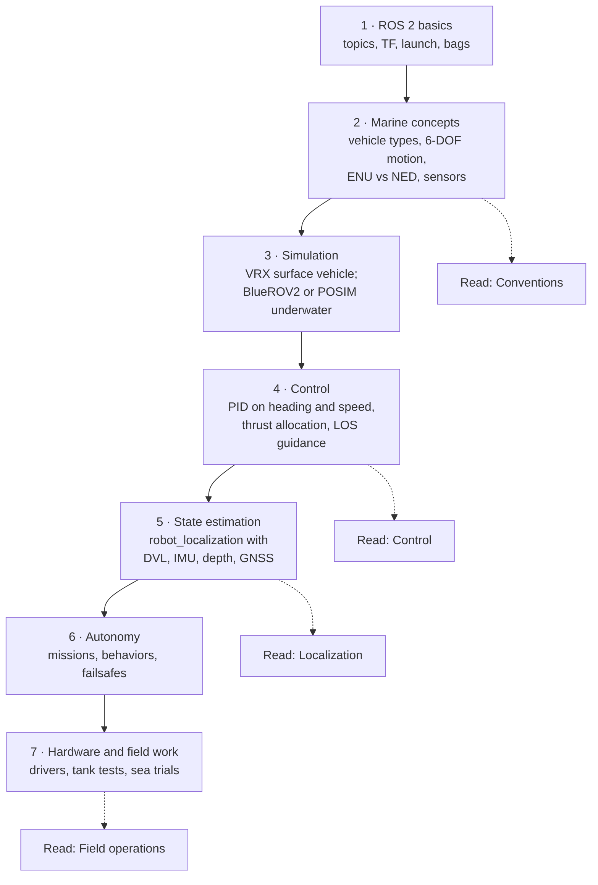

# Learning path and tutorials

!!! note "Before you start"

    These tutorials assume basic ROS 2 knowledge: nodes, topics, parameters, and launch files. If you are new to ROS, do the official [ROS 2 Jazzy tutorials](https://docs.ros.org/en/jazzy/Tutorials.html) first, and read [Getting started](getting_started.md).

## Learning path



Concepts that differ from land robotics, and where they are explained:

1. **Vehicle dynamics** in 6 DOF, with added mass, damping, and buoyancy: [Control](control.md), and Fossen's handbook below.
2. **Coordinate frames**: ENU and FLU in ROS, NED and FRD in marine instruments: [Conventions](conventions.md).
3. **Environmental forces**: currents, waves, and wind: [Simulation](simulation.md).
4. **Sensor limits**: no GNSS underwater, slow acoustic links, short camera range: [Localization](navigation.md), [Communication](communication.md), [Perception](perception.md).

## Tutorials

### Tutorial 1: Drive a boat in VRX

**Goal**: run the Virtual RobotX simulation and drive the WAM-V with thrust commands.

1. **Install** ROS 2 Jazzy and Gazebo Harmonic, then build VRX by following the [VRX installation tutorial](https://github.com/osrf/vrx/wiki). The default `jazzy` branch targets this combination.
2. **Launch** a world:

    ```bash
    ros2 launch vrx_gz competition.launch.py world:=sydney_regatta
    ```

3. **Look around** in a second terminal:

    ```bash
    ros2 topic list | grep wamv
    ros2 topic info /wamv/thrusters/left/thrust    # std_msgs/msg/Float64
    ```

4. **Drive forward**, then turn by commanding the two thrusters differently:

    ```bash
    ros2 topic pub -r 10 /wamv/thrusters/left/thrust std_msgs/msg/Float64 "{data: 200.0}" &
    ros2 topic pub -r 10 /wamv/thrusters/right/thrust std_msgs/msg/Float64 "{data: 200.0}"
    ```

    Stop both commands with ++ctrl+c++ (and `kill %1` for the background one). Change one value to make the boat turn.

**Next steps**: write a Python node that reads the boat's pose and controls heading with a PID loop; then try the VRX tasks (station keeping, wayfinding). The [VRX wiki](https://github.com/osrf/vrx/wiki) has tutorials for each.

### Tutorial 2: Thrust allocation by hand

**Goal**: understand how a multi-thruster vehicle turns a desired force and moment into thruster commands.

Work through the [tested allocation example](control.md#tested-example) on the Control page. Then:

1. Change the thruster angles and see how the condition number of \( T \) changes.
2. Increase the demand until a thruster saturates, and compare clipping with uniform scaling.
3. Remove one thruster (delete its column) and check which wrenches are still possible. This is how allocation handles a thruster failure.

### Tutorial 3: Fuse a DVL with robot_localization

**Goal**: dead-reckon an underwater vehicle from DVL velocity, IMU attitude, and depth.

1. **Get data**: use a simulator with a DVL (Gazebo's DopplerVelocityLog system, POSIM, or Stonefish), or a real DVL with its ROS 2 driver (for example [waterlinked_dvl](https://github.com/waterlinked/waterlinked_dvl)).
2. **Check the messages**: robot_localization takes DVL velocity as `geometry_msgs/TwistWithCovarianceStamped` in the DVL frame, with a non-zero covariance. If the driver publishes only `marine_acoustic_msgs/Dvl`, add a small conversion node.
3. **Check the transforms**: `base_link → dvl_link`, `base_link → imu_link`, and `base_link → pressure_link` must exist (from the URDF).
4. **Configure the EKF** with the [local EKF configuration](navigation.md#robot_localization-configurations): DVL as `twist0`, IMU as `imu0`, depth as `pose0` with only z.
5. **Verify**: drive a square in simulation and compare `/odometry/local` with the simulator's ground truth in PlotJuggler. Then turn off the DVL input and watch the drift grow.

### Tutorial 4: Turn a USBL fix into a position

**Goal**: understand the geometry of an ultra-short baseline fix.

A USBL transceiver measures the **slant range** \( r \) (from travel time and sound speed) and the direction to the vehicle as an **azimuth** \( \beta \) and a **depression angle** \( \gamma \) below horizontal, in the transceiver's frame. In an ENU-aligned transceiver frame (azimuth counter-clockwise from east, z up), the vehicle position is

\[
x = r\cos\gamma\cos\beta, \qquad y = r\cos\gamma\sin\beta, \qquad z = -r\sin\gamma
\]

A real system must also add the transceiver's own position and attitude (from the ship's GNSS and INS), and correct for the sound speed profile. Vendor USBL systems do all of this and output a georeferenced position; this example shows only the core geometry.

```python title="usbl_to_point.py"
import math

import rclpy
from geometry_msgs.msg import PointStamped
from rclpy.node import Node


def usbl_to_enu(slant_range, azimuth, depression):
    """Range (m) and angles (rad) in an ENU-aligned transceiver frame -> x, y, z (m)."""
    horizontal = slant_range * math.cos(depression)
    return (horizontal * math.cos(azimuth),
            horizontal * math.sin(azimuth),
            -slant_range * math.sin(depression))


class UsblDemo(Node):
    def __init__(self):
        super().__init__("usbl_demo")
        self.pub = self.create_publisher(PointStamped, "usbl/position", 10)
        self.timer = self.create_timer(1.0, self.publish_fix)

    def publish_fix(self):
        # Example fix: 120 m slant range, 30 degrees azimuth, 40 degrees below horizontal
        x, y, z = usbl_to_enu(120.0, math.radians(30.0), math.radians(40.0))
        msg = PointStamped()
        msg.header.stamp = self.get_clock().now().to_msg()  # use the ping time on real data
        msg.header.frame_id = "usbl_transceiver"
        msg.point.x, msg.point.y, msg.point.z = x, y, z
        self.pub.publish(msg)


def main():
    rclpy.init()
    rclpy.spin(UsblDemo())


if __name__ == "__main__":
    main()
```

For the example numbers, the vehicle is about 79.6 m east, 46.0 m north, and 77.1 m below the transceiver.

**Challenges in practice**: outliers from multipath, latency between the ping and the arrival of the fix on the vehicle, and covariance that grows with range. See [acoustic positioning](navigation.md#acoustic-positioning).

## Courses and open course material

| Resource | Content |
|---|---|
| [MIT 2.680, Unmanned Marine Vehicle Autonomy, Sensing and Communications](https://oceanai.mit.edu/) | MOOS-IvP based course; lecture notes and labs on the oceanai site |
| [Marine Systems Simulator (MSS)](https://github.com/cybergalactic/MSS) | MATLAB toolbox with vessel and vehicle models, guidance, and control, by T. I. Fossen |
| [Python Vehicle Simulator](https://github.com/cybergalactic/PythonVehicleSimulator) | Python companion to MSS: AUV, USV, and ship models with control examples |
| [REMARO hackathon (TU Delft, 2022)](https://github.com/remaro-network/tudelft_hackathon) | Hands-on ROS 2 and Gazebo exercises for underwater robots |
| [VRX tutorials](https://github.com/osrf/vrx/wiki) | Step-by-step surface vehicle simulation |
| [ROS 2 documentation](https://docs.ros.org/en/jazzy/) | Official tutorials and concepts |

Many universities publish marine robotics course material, including NTNU (marine cybernetics), the University of Girona, the University of Porto, and TU Delft. Search their course pages for current links.

## Books

- T. I. Fossen, *Handbook of Marine Craft Hydrodynamics and Motion Control*, 2nd ed., Wiley, 2021. Vehicle models, guidance, navigation, and control. The standard reference.
- G. Antonelli, *Underwater Robots*, 4th ed., Springer, 2018. Modeling, control, and intervention for underwater vehicles.
- G. Griffiths (ed.), *Technology and Applications of Autonomous Underwater Vehicles*, Taylor & Francis, 2003. AUV systems and operations.
- S. W. Moore, H. Bohm, V. Jensen, *Underwater Robotics: Science, Design & Fabrication*, MATE Center, 2010. Practical ROV design; popular with student teams.

## Video channels

- [Woods Hole Oceanographic Institution](https://www.youtube.com/@WHOI): vehicles and expeditions.
- [Blue Robotics](https://www.youtube.com/user/BlueRobotics): ROV and USV setup and operation.
- ROSCon and working group meeting recordings: see [Community](community.md#meetings).

## WHOI Deep Submergence Lab and acoustic communications

The Woods Hole Oceanographic Institution operates deep submergence vehicles such as *Alvin*, *Jason*, and *Sentry*, and develops the WHOI Micro-Modem. Its public software includes [ros_acomms](https://acomms.pages.whoi.edu/ros_acomms/overview.html) for acoustic communication and the Deep Submergence Lab's [Bitbucket workspace](https://bitbucket.org/whoidsl/workspace/repositories/) (ROS 1 drivers and ds_sim). Both are good examples of software that has been used in real operations.
