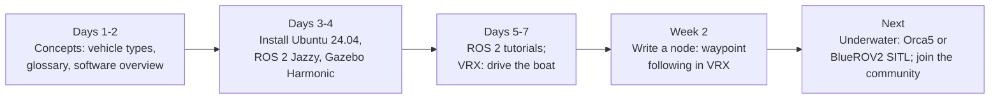

# Getting started

Marine robots map the seafloor, inspect ship hulls, dams, and offshore wind farms, monitor water quality, study marine life, and support search and rescue. If you are new to the field, this page gets you from curious to driving a simulated vehicle, without any hardware.

## What you need

| You need | You do not need |
|---|---|
| A computer that can run Linux (natively, in a virtual machine, or in WSL 2 on Windows) | A boat, a pool, or an ocean |
| Interest, patience, and some programming (Python is enough to start) | An engineering degree |
| Time to learn ROS basics | Expensive hardware: start in simulation |

**Programming**: Python is enough for most beginner work; C++ is common for drivers and performance-critical code. **Math**: trigonometry and vectors come first; linear algebra and control theory come later, when you need them.

## Choose your path

-   :material-eye-outline:{ .lg } **Explore** · *an afternoon*

    ---

    1. Read [Vehicle types](vehicle_types.md) to see the main kinds of marine robots.
    2. Skim the [Glossary](glossary.md); hover over any acronym on this site to see its meaning.
    3. Look at the [software overview](software.md) to see how a vehicle's software fits together.

-   :material-gamepad-variant-outline:{ .lg } **Simulate** · *a weekend*

    ---

    1. Install Ubuntu 24.04 and [ROS 2 Jazzy](https://docs.ros.org/en/jazzy/Installation.html).
    2. Do the first [ROS 2 tutorials](https://docs.ros.org/en/jazzy/Tutorials.html) (topics, nodes, launch).
    3. Install [VRX](https://github.com/osrf/vrx/wiki) and drive the simulated boat: [Tutorial 1](education_and_tutorials.md#tutorial-1-drive-a-boat-in-vrx).

-   :material-hammer-wrench:{ .lg } **Build** · *a semester*

    ---

    1. Join a student team or a lab (see [Events](events.md) for MATE ROV, RoboSub, SAUVC, and RobotX).
    2. Start with a tethered ROV: tethers make testing and recovery easy.
    3. Follow the [field operations](operations.md) checklists from the first pool test.

## Your first two weeks

!!! tip "Which ROS version?"

    Use **ROS 2 Jazzy** on **Ubuntu 24.04** with **Gazebo Harmonic**. Most maritime packages and tutorials target this combination in 2026. Do not start new work on ROS 1: its last release (Noetic) reached end of life in May 2025. See the [platform baseline](index.md#current-platform-baseline-october-2026).

**On Windows**, use [WSL 2](https://learn.microsoft.com/windows/wsl/install) with Ubuntu 24.04. Gazebo runs in WSL 2 with GPU support on recent Windows versions, but a native Linux install is faster and causes fewer problems. **On macOS**, use a Linux virtual machine or a remote Linux computer; ROS 2 and Gazebo on macOS have limited support.

## Simulators for a first project

| Simulator | Vehicle | Why start here |
|---|---|---|
| [VRX](https://github.com/osrf/vrx) | Surface vehicle (WAM-V) | Good tutorials, ROS 2 Jazzy, competition tasks to try |
| [Orca5](https://github.com/clydemcqueen/orca5) | BlueROV2 | Real ArduSub firmware in Gazebo, Docker setup |
| [TurtleBoat](https://github.com/bartboogmans/TurtleBoat) | Small ship | Very light; learn vessel dynamics like turtlesim |
| [Python Vehicle Simulator](https://github.com/cybergalactic/PythonVehicleSimulator) | AUVs, USVs, ships | No ROS needed; models from Fossen's textbook |

## Hardware when you are ready

- **Join a team first.** University clubs and competition teams share vehicles, tools, and experience.
- **BlueROV2** (Blue Robotics) is the most common research and education ROV, with ArduSub, a large community, and ROS 2 integrations (Blue, Orca, ardusub_driver).
- **BlueBoat** (Blue Robotics) is a small ArduPilot-based USV for surface projects.
- **Build your own** small ROV from thrusters, a housing, and a flight controller with ArduSub. Budget for spares and for safe pool access.

## Get help

- **Questions**: post on [ROS Discourse, Marine Robotics](https://discourse.openrobotics.org/c/community-groups/marine-robotics/36) or [Robotics Stack Exchange](https://robotics.stackexchange.com/) (tag `ros2`).
- **Chat**: the [Zulip Marine Robotics channel](https://openrobotics.zulipchat.com/#narrow/channel/526058-Marine-Robotics).
- **Meetings**: the monthly [working group meeting](community.md#meetings) is open to everyone, including beginners.
- **Answers to common questions**: [FAQ](faq.md).

When you ask, include what you tried, the exact error message, and your ROS and Ubuntu versions.
