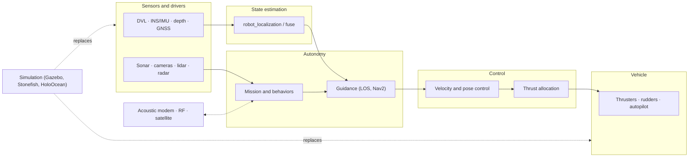

# The open map of ROS maritime robotics

Software, simulators, drivers, conventions, and field know-how for surface and underwater robots, curated by the ROS Maritime Community Working Group.

[Get started](getting_started.md){ .md-button .md-button--primary }
[Browse the package catalog](catalog.md){ .md-button }
[Join the working group](community.md){ .md-button }

<svg class="mrl-hero__waves" viewBox="0 0 1440 80" preserveAspectRatio="none" aria-hidden="true"><path class="back" d="M0 40c120 20 240 30 360 20s240-40 360-40 240 30 360 40 240-10 360-20v80H0z"/><path d="M0 56c160 14 320 18 480 6s320-30 480-26 320 26 480 26v18H0z"/></svg>

<!-- catalog:stats -->

## Where do you want to start?

-   :material-school-outline:{ .lg } **New to marine robotics**

    ---

    Learn the vehicle types and core ideas, then drive a simulated boat or ROV on your own laptop. No hardware needed.

    [:octicons-arrow-right-24: Getting started](getting_started.md)

-   :material-code-braces:{ .lg } **Software developer**

    ---

    Find maintained ROS 2 packages, check the frame conventions, and copy proven integration patterns.

    [:octicons-arrow-right-24: Software overview](software.md)

-   :material-ferry:{ .lg } **Building a vehicle**

    ---

    Compare DVLs, INS units, sonars, and thrusters, and see which ones have maintained ROS 2 drivers.

    [:octicons-arrow-right-24: Sensors and components](hardware.md)

-   :material-lifebuoy:{ .lg } **Going to sea**

    ---

    Checklists, power budgets, failure modes, and lessons learned from field deployments.

    [:octicons-arrow-right-24: Field operations](operations.md)

## How the pieces fit

A typical ROS 2 marine vehicle has the same layers whatever its hull shape. Each box links to the page that covers that layer.

## Current platform baseline (October 2026)

!!! tip "Recommended for new projects"

    Use **ROS 2 Jazzy** with **Gazebo Harmonic** on **Ubuntu 24.04**. Most maintained maritime packages target this pair, for example VRX, Orca5, auv_controllers, ardusub_driver, and the MVP jazzy branches. Use **ROS 2 Lyrical** with **Gazebo Jetty** on Ubuntu 26.04 if a dependency needs it (for example POSIM, the ROS 2 version of DAVE). Plan to leave Humble before its end of life in May 2027.

| Release | Type | Ubuntu | Gazebo pairing | Supported until |
|---|---|---|---|---|
| ROS 2 Lyrical Luth | LTS, May 2026 | 26.04 (24.04 also) | Jetty | May 2031 |
| ROS 2 Kilted Kaiju | Non-LTS, May 2025 | 24.04 | Ionic | Late 2026 |
| **ROS 2 Jazzy Jalisco** | **LTS, May 2024** | **24.04** | **Harmonic** | **May 2029** |
| ROS 2 Humble Hawksbill | LTS, May 2022 | 22.04 | Fortress | May 2027 |
| ROS 1 Noetic | Last ROS 1 release | 20.04 | Gazebo Classic 11 | **Ended May 2025** |

Gazebo Classic reached end of life in January 2025. Sources: [ROS 2 releases](https://docs.ros.org/en/rolling/Releases.html), [Gazebo releases](https://gazebosim.org/docs/latest/releases/), [Gazebo and ROS pairings](https://gazebosim.org/docs/latest/ros_installation/).

## What is on this site

-   :material-view-grid-outline: **[Package catalog](catalog.md)**: search and filter more than 100 projects by purpose, ROS version, vehicle, and activity.
-   :material-axis-arrow: **[Frames and conventions](conventions.md)**: ENU and NED, FLU and FRD, heading versus yaw, depth and pressure.
-   :material-cube-scan: **[Simulation](simulation.md)**: choose a simulator by vehicle, sensors, and engine.
-   :material-compass-outline: **[Drivers and interfaces](drivers.md)**: which DVL, INS, and sonar vendors have maintained ROS 2 drivers.
-   :material-access-point-network: **[Communication](communication.md)**: acoustic modems, satellite, and robot-to-shore middleware.
-   :material-database-outline: **[Datasets](datasets.md)**: sonar, underwater imagery, USV perception, and navigation datasets.
-   :material-calendar-star: **[Events](events.md)**: RobotX, RoboSub, MATE, SAUVC, OCEANS, and community meetings.
-   :material-book-alphabet: **[Glossary](glossary.md)**: plain-language definitions. Hover over an acronym on any page to see its meaning.

## Help keep this accurate

This is a community resource. Package activity refreshes every week from the repositories themselves, but descriptions and recommendations need people who use the tools. If you see something wrong or missing, use the :material-pencil: button at the top of any page, or read [Contributing](contributing.md).
