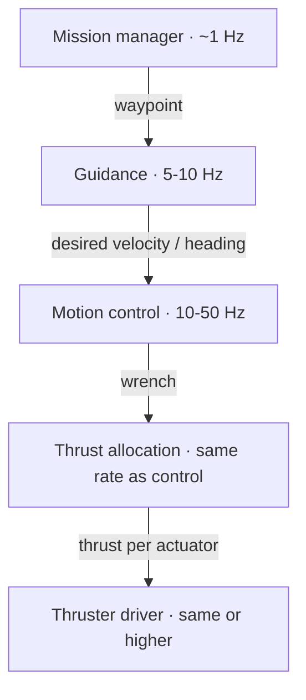

# Integration examples

Reference architectures and launch patterns that recur across marine vehicles. They are starting points: adapt sensor models, frame IDs, ports, rates, and vehicle parameters to your system, and test in simulation first.

!!! warning "Illustrative, not drop-in"

    Package and executable names for robot_localization, robot_state_publisher, and tf2 are real. Driver package names (`your_dvl_driver` and similar) are placeholders. Always check parameter names against the documentation of the version you use.

## Reference architectures

=== "Survey AUV (torpedo)"

    Forward propulsion with control surfaces or a vectored thruster. Flies survey lines at constant altitude or depth.

    ```mermaid
    flowchart LR
      DVL["DVL<br/>bottom-track velocity, altitude"] --> EKF
      INS["INS<br/>attitude, rates"] --> EKF
      DEP["Pressure<br/>depth"] --> EKF
      GNSS["GNSS<br/>surface only"] -.-> NST["navsat_transform"] -.-> EKFG
      EKF["EKF local<br/>odom → base_link"] --> CTRL
      EKFG["EKF global<br/>map → odom"] --> MIS
      MIS["Mission<br/>survey lines"] --> GUID["LOS guidance<br/>course, depth or altitude"]
      GUID --> CTRL["Speed, heading,<br/>depth / pitch control"] --> ACT["Thruster + fins"]
      SSS["Side-scan / MBES"] --> LOG[("rosbag2")]
    ```

    - Underactuated: control surge, heading, and depth or pitch; no sway control.
    - GNSS fixes only at the surface; dead reckoning between them. Add USBL or LBL for long dives.
    - Payload sonars usually log raw data for post-processing rather than feeding the autonomy.

=== "Hovering AUV / ROV (inspection)"

    Four or more thrusters, 4 to 6 controlled DOF, station keeping near structures.

    ```mermaid
    flowchart LR
      DVL["DVL"] --> EKF
      IMU["INS / AHRS"] --> EKF
      DEP["Pressure"] --> EKF
      USBL["USBL fix<br/>low rate, outliers"] -.-> EKFG["EKF global"]
      EKF["EKF local"] --> CTRL["Pose / velocity<br/>controller (6-DOF)"]
      CTRL -->|"wrench"| ALLOC["Thrust allocation"] --> THR["Thrusters"]
      CAM["Cameras"] --> PER["Perception"]
      FLS["Forward-looking sonar"] --> PER
      PER --> SUP["Mission supervisor"] --> CTRL
    ```

    - Fully actuated in the horizontal plane; allocation must handle saturation.
    - Magnetic heading is unreliable close to steel structures; prefer a gyro-based INS or visual or sonar heading aids.
    - Tethered ROVs can run heavy processing topside.

=== "ASV (survey)"

    Twin thrusters or rudder and propeller, GNSS-based navigation.

    ```mermaid
    flowchart LR
      GNSS["GNSS (RTK)"] --> NST["navsat_transform"] --> EKF["EKF"]
      IMU["IMU / dual-antenna heading"] --> EKF
      EKF --> NAV["Nav2 or LOS guidance"]
      RAD["Radar · lidar · AIS · camera"] --> COST["Obstacle map / tracker"] --> NAV
      NAV --> CTRL["Speed and heading control"] --> THR["Thrusters / rudder"]
      MBES["Multibeam"] --> LOG[("rosbag2")]
    ```

    - Heading at low speed comes from the IMU or a dual-antenna GNSS, not from the GNSS course.
    - Measure antenna and transducer lever arms; survey data depends on them.

## Launch pattern: sensors and localization

A ROS 2 Python launch file that starts the vehicle description, two drivers, and the local EKF. Use the EKF configuration from [Localization](navigation.md#robot_localization-configurations).

```python title="launch/localization.launch.py"
import os

from ament_index_python.packages import get_package_share_directory
from launch import LaunchDescription
from launch.actions import DeclareLaunchArgument
from launch.substitutions import Command, LaunchConfiguration
from launch_ros.actions import Node
from launch_ros.parameter_descriptions import ParameterValue


def generate_launch_description():
    pkg = get_package_share_directory("my_vehicle_bringup")
    use_sim_time = LaunchConfiguration("use_sim_time")

    robot_description = ParameterValue(
        Command(["xacro ", os.path.join(pkg, "urdf", "vehicle.urdf.xacro")]),
        value_type=str,
    )

    return LaunchDescription([
        DeclareLaunchArgument("use_sim_time", default_value="false"),

        # Static transforms base_link -> sensors come from the URDF
        Node(
            package="robot_state_publisher",
            executable="robot_state_publisher",
            parameters=[{"robot_description": robot_description,
                         "use_sim_time": use_sim_time}],
        ),

        # Placeholder driver packages: replace with your real drivers
        Node(
            package="your_dvl_driver",
            executable="dvl_node",
            parameters=[os.path.join(pkg, "config", "dvl.yaml"),
                        {"use_sim_time": use_sim_time}],
            remappings=[("twist", "/dvl/twist")],
        ),
        Node(
            package="your_depth_driver",
            executable="depth_node",
            parameters=[{"frame_id": "pressure_link",
                         "use_sim_time": use_sim_time}],
            remappings=[("pose", "/depth/pose")],
        ),

        # Local EKF: publishes odom -> base_link and /odometry/local
        Node(
            package="robot_localization",
            executable="ekf_node",
            name="ekf_local",
            parameters=[os.path.join(pkg, "config", "ekf_local.yaml"),
                        {"use_sim_time": use_sim_time}],
            remappings=[("odometry/filtered", "/odometry/local")],
        ),
    ])
```

For thrust allocation, run an allocator that reads the thruster layout from the same URDF, for example `ros2 run thruster_manager thruster_manager_node` (see the [thruster_manager README](https://github.com/CentraleNantesROV/thruster_manager) for its parameters), or the thruster allocation matrix controller from [auv_controllers](https://github.com/Robotic-Decision-Making-Lab/auv_controllers) under ros2_control.

## TF trees

=== "Torpedo AUV"

    ```text
    map                     (ENU, local datum; GNSS / USBL corrections)
     └─ odom                (ENU, continuous; DVL + INS + depth)
         └─ base_link       (FLU, vehicle reference point)
             ├─ dvl_link
             ├─ ins_link
             ├─ pressure_link
             ├─ gnss_link
             ├─ sidescan_port_link / sidescan_stbd_link
             └─ propeller_link
    ```

=== "Hovering ROV with manipulator"

    ```text
    map
     └─ odom
         └─ base_link
             ├─ dvl_link
             ├─ imu_link
             ├─ camera_front_link ── camera_front_optical_frame
             ├─ fls_link
             ├─ thruster_1_link … thruster_8_link
             └─ arm_base_link ── arm_link_1 ── … ── gripper_link   (joint states)
    ```

=== "ASV"

    ```text
    map                     (ENU or UTM-aligned)
     └─ odom
         └─ base_link
             ├─ gnss_primary_link / gnss_secondary_link   (dual antenna)
             ├─ imu_link
             ├─ lidar_link
             ├─ radar_link
             └─ mbes_link
    ```

Define the static sensor transforms in the URDF, with measured offsets:

```xml
<joint name="base_to_dvl" type="fixed">
  <parent link="base_link"/>
  <child link="dvl_link"/>
  <!-- 0.15 m forward, 0.10 m below base_link; FLU, so down is negative z -->
  <origin xyz="0.15 0 -0.10" rpy="0 0 0"/>
</joint>
```

## Control loop rates

Run inner loops faster than the vehicle dynamics, and outer loops slower:



The rates are typical orders of magnitude, not requirements. The EKF should run at least as fast as the controller that uses it.

## Sensor timing

- **Hardware timing (best):** distribute PPS from the GNSS receiver, and use PTP on the vehicle network. Sensors that accept a sync input stamp data in a common time base.
- **Software timing:** chrony or NTP on all computers. Stamp at the time of measurement when the device reports it.
- For processing that needs several sensors together (for example camera and sonar), use `message_filters` with an approximate time policy:

```python
from message_filters import ApproximateTimeSynchronizer, Subscriber
from nav_msgs.msg import Odometry
from rclpy.node import Node
from sensor_msgs.msg import Image


class CameraWithPose(Node):
    def __init__(self):
        super().__init__("camera_with_pose")
        image_sub = Subscriber(self, Image, "/camera/image_raw")
        odom_sub = Subscriber(self, Odometry, "/odometry/local")
        self.sync = ApproximateTimeSynchronizer([image_sub, odom_sub], queue_size=10, slop=0.05)
        self.sync.registerCallback(self.callback)

    def callback(self, image, odom):
        self.get_logger().info(f"image at {image.header.stamp.sec}, pose x={odom.pose.pose.position.x:.2f}")
```

## Troubleshooting

??? question "Could not find a connection between 'map' and 'base_link'"

    ```bash
    ros2 run tf2_tools view_frames      # writes frames.pdf with the tree
    ros2 run tf2_ros tf2_echo map base_link
    ros2 topic hz /tf
    ```

    Usual causes: the global EKF (map → odom) is not running or has no absolute input yet, a static transform is missing, or two nodes publish the same transform.

??? question "The EKF output jumps or drifts away"

    See [EKF divergence](navigation.md#known-issues): check timestamps first, then covariances, then frames.

??? question "The vehicle cannot hold position, thrusters always saturate"

    - Trim the buoyancy and balance first; a vehicle that needs constant vertical thrust has little margin left.
    - Compare the desired wrench with the achieved wrench (\( T f \)) from the allocator.
    - Check the allocation matrix condition number and the thruster directions in the URDF; a reversed thruster looks like saturation.
    - Reduce commanded speeds, or add thrust.
