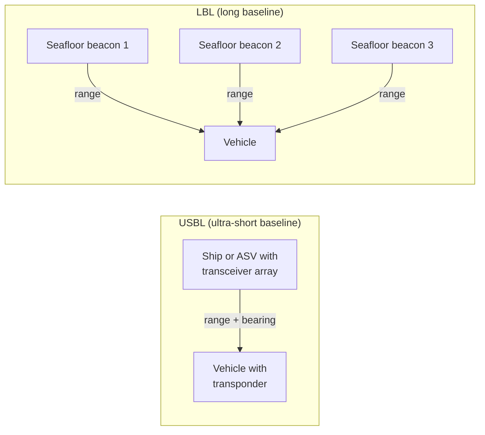

# Localization and navigation

GNSS signals do not go through water, so an underwater vehicle estimates its position from dead reckoning (DVL and INS), corrects it with occasional acoustic or surface GNSS fixes, and uses a pressure sensor for depth. Surface vehicles have GNSS but must deal with heading, waves, and multipath.

## Sensor combinations

| Vehicle | Typical sensors | Position accuracy driver |
|---|---|---|
| Survey AUV | DVL + INS (often fiber-optic gyro) + depth; GNSS at the surface; USBL or LBL in some missions | DVL bottom lock and INS heading quality; drift grows with distance traveled |
| Hovering AUV / ROV | DVL + IMU or AHRS + depth; optional USBL; visual odometry close to structures | Heading from the magnetometer is unreliable near thrusters and steel |
| Tethered ROV | IMU + depth; position from the topside USBL if needed | Topside USBL accuracy |
| ASV | GNSS (RTK for survey) + IMU; dual-antenna GNSS for heading | GNSS quality; heading at low speed |
| Glider | Depth, attitude, dead reckoning from the flight model; GNSS at each surfacing | Long dead-reckoning intervals and unknown currents |

## Packages

<!-- catalog:table category=navigation -->

## Dead reckoning with a DVL

A Doppler Velocity Log measures velocity from the Doppler shift of acoustic beams (usually four).

- **Bottom track**: velocity relative to the seafloor. This is what you want for navigation. It needs the seafloor within range; range depends on the DVL frequency (higher frequency, shorter range, finer resolution).
- **Water track**: velocity relative to a layer of water. In a current this is *not* velocity over ground, so the integrated position drifts by roughly the current speed times the time. Use it only to bridge short gaps, and give it a large covariance.
- The DVL measures in its own frame. Publish its mounting transform, and remember that a lever arm from `base_link` adds a velocity term from rotation (see [conventions](conventions.md#the-frame-tree-on-a-vessel-rep-105)).

## Acoustic positioning



| System | How | Pros | Cons |
|---|---|---|---|
| USBL | Topside array measures range (travel time) and bearing (phase) to the vehicle | One topside unit; easy to deploy | Error grows with range; needs the ship's GNSS and attitude; the fix is computed topside and must be sent to the vehicle |
| LBL | Vehicle measures ranges to surveyed seafloor beacons | Good accuracy over a fixed area | Beacons must be deployed, surveyed, and recovered |
| SBL | Several transducers on the hull of the support vessel | No seafloor work | Accuracy limited by the hull baseline |
| Single-beacon range | Ranges to one beacon (for example on the modem) while moving | Cheap with an acoustic modem | Needs motion for observability |

Fuse acoustic fixes in the **map** frame estimator as absolute pose measurements with realistic covariance and outlier rejection. Account for latency: the fix refers to the time of the ping, not the time it reached the vehicle.

## robot_localization configurations

Use two estimators, per REP 105: a **local** EKF (odom frame) with continuous inputs, and a **global** EKF (map frame) that also takes absolute fixes. The configurations below are minimal, working starting points. Topic names are examples.

=== "Local EKF (odom → base_link)"

    ```yaml title="config/ekf_local.yaml"
    ekf_local:
      ros__parameters:
        frequency: 30.0
        two_d_mode: false
        publish_tf: true
        map_frame: map
        odom_frame: odom
        base_link_frame: base_link
        world_frame: odom

        # DVL: body-frame velocity, geometry_msgs/TwistWithCovarianceStamped
        twist0: /dvl/twist
        twist0_config: [false, false, false,   # x, y, z
                        false, false, false,   # roll, pitch, yaw
                        true,  true,  true,    # vx, vy, vz
                        false, false, false,   # vroll, vpitch, vyaw
                        false, false, false]   # ax, ay, az

        # IMU / INS: orientation and angular rate, sensor_msgs/Imu in ENU / FLU
        imu0: /imu/data
        imu0_config: [false, false, false,
                      true,  true,  true,
                      false, false, false,
                      true,  true,  true,
                      false, false, false]
        imu0_remove_gravitational_acceleration: true

        # Depth: absolute z (negative below the surface),
        # geometry_msgs/PoseWithCovarianceStamped with only z set
        pose0: /depth/pose
        pose0_config: [false, false, true,
                       false, false, false,
                       false, false, false,
                       false, false, false,
                       false, false, false]
    ```

=== "Global EKF (map → odom)"

    ```yaml title="config/ekf_global.yaml"
    ekf_global:
      ros__parameters:
        frequency: 30.0
        two_d_mode: false
        publish_tf: true
        map_frame: map
        odom_frame: odom
        base_link_frame: base_link
        world_frame: map

        twist0: /dvl/twist
        twist0_config: [false, false, false, false, false, false,
                        true,  true,  true,  false, false, false,
                        false, false, false]
        imu0: /imu/data
        imu0_config: [false, false, false, true,  true,  true,
                      false, false, false, true,  true,  true,
                      false, false, false]
        pose0: /depth/pose
        pose0_config: [false, false, true,  false, false, false,
                       false, false, false, false, false, false,
                       false, false, false]

        # GNSS (surface only), converted to the map frame by navsat_transform_node
        odom0: /odometry/gps
        odom0_config: [true,  true,  false, false, false, false,
                       false, false, false, false, false, false,
                       false, false, false]

        # USBL or LBL fix in the map frame, with outlier rejection
        pose1: /usbl/pose
        pose1_config: [true,  true,  false, false, false, false,
                       false, false, false, false, false, false,
                       false, false, false]
        pose1_rejection_threshold: 5.0   # Mahalanobis distance

        smooth_lagged_data: true         # accept fixes that arrive late
        history_length: 10.0             # seconds; longer than the acoustic latency
    ```

=== "navsat_transform_node"

    ```yaml title="config/navsat.yaml"
    navsat_transform:
      ros__parameters:
        frequency: 10.0
        magnetic_declination_radians: 0.0  # set for your site if the IMU yaw is magnetic
        yaw_offset: 0.0                    # pi/2 if the IMU reports 0 when facing north
        zero_altitude: true
        publish_filtered_gps: true
        use_odometry_yaw: false
        wait_for_datum: false
        # Remap: imu -> /imu/data, gps/fix -> /gnss/fix,
        #        odometry/filtered -> /odometry/global, odometry/gps (output)
    ```

!!! note "Things the configurations do not do for you"

    - **Covariances.** The EKF trusts each input according to its covariance. Every driver must publish realistic values; zero covariance makes the filter fail.
    - **GNSS underwater.** Gate the GNSS input (for example drop fixes when depth is more than about 0.5 m, or when the fix quality is poor), so that stale or multipath fixes do not pull the estimate.
    - **Heading reference.** If the IMU heading is magnetic, it is unreliable close to thrusters, batteries, and steel. A fiber-optic or ring-laser gyro INS gives true heading by gyrocompassing.

## Known issues

??? warning "DVL"

    - **Bottom lock lost**: at high altitude, over soft sediment, on steep slopes, or in aerated water. The estimate then drifts at the rate of the INS alone. Plan missions inside bottom-lock range, and monitor the DVL status flag.
    - **Acoustic interference** with sonars and modems: corrupted sonar images and modem packet loss. Trigger sensors in turn or choose separated frequencies.
    - **Thruster noise and bubbles** degrade returns during high thrust. Mount the DVL away from thrusters.
    - **Water track in currents**: see above. Do not treat it as velocity over ground.

??? warning "EKF divergence"

    Root causes, from most to least common:

    1. Timestamps wrong (wall time instead of ROS time, or stamped at the time of reception)
    2. Covariances too small, so the filter is too confident in a bad sensor
    3. Frame errors (NED data published as ENU, missing or wrong transform)
    4. Bad initial state

    Debug:

    ```bash
    ros2 run tf2_tools view_frames                   # one connected tree?
    ros2 topic echo /diagnostics                     # robot_localization warnings
    ros2 topic hz /dvl/twist /imu/data               # rates as expected?
    ros2 topic echo /dvl/twist --field header.stamp  # stamps close to now?
    ```

    Fixes: correct the timestamps first, then *increase* the covariance of the doubtful sensor (less trust), increase process noise, and disable inputs one at a time to find the culprit. Plot innovations in PlotJuggler: they should be zero-mean.

??? warning "Intermittent absolute fixes (GNSS, USBL)"

    - **Jumps in the map frame** are expected when a fix corrects accumulated drift. Controllers should run on the continuous `odom` estimate, and only planners should use `map`.
    - **Outliers** from multipath, refraction at thermoclines, or biologic noise: use `poseN_rejection_threshold`, a median pre-filter, or a gate on the reported quality.
    - **Shadow zones**: refraction at thermoclines can block acoustic paths. The vehicle then navigates on DVL and INS only.

??? warning "Covariance tuning takes time"

    1. Start with the manufacturers' noise figures.
    2. Set process noise high, then lower it.
    3. Tune one sensor at a time against ground truth (a survey line, a GNSS track at the surface, or a tank with motion capture).
    4. Check that innovations are zero-mean and consistent with their covariance.

## Path planning

- **Surface vehicles**: Nav2 works with an ASV modeled as a differential-drive or Ackermann-like robot on a 2D costmap. Add obstacles from radar, lidar, AIS, and charts. COLREGs-aware avoidance is not built in.
- **Underwater**: most missions are pre-planned survey lines or waypoints. 3D planning near structures can use mesh_navigation or a custom planner. Always plan with margins for navigation drift.
