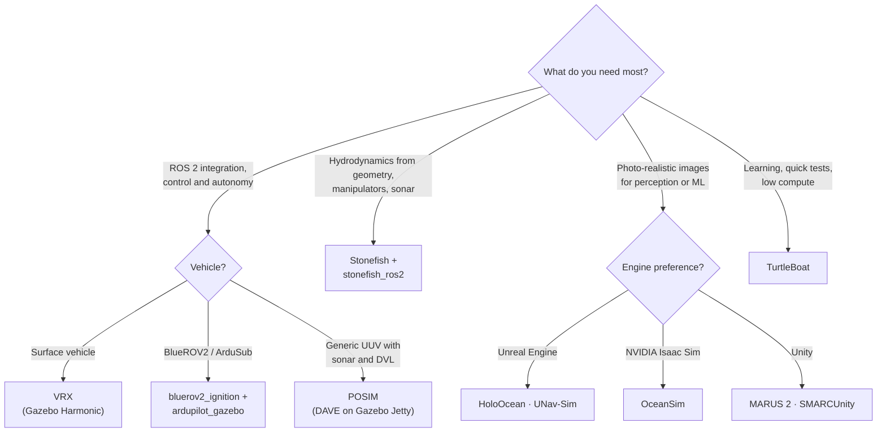

# Simulation

Sea time is expensive and slow, so most marine robotics software is developed and tested in simulation first. This page groups simulators by the engine they use, and helps you choose one.

## Choose a simulator

| Need | Good options | Why |
|---|---|---|
| Surface vehicle autonomy, competitions | VRX | Waves, wind, WAM-V model, RobotX tasks, ROS 2 Jazzy |
| ArduSub software-in-the-loop | bluerov2_ignition, ardupilot_gazebo, Orca5 | Runs the real ArduSub firmware against Gazebo |
| Underwater sonar and DVL in Gazebo | POSIM (DAVE), gz-sim DVL system | Maintained sensor plugins on current Gazebo |
| Accurate hydrodynamics and manipulation | Stonefish | Computes added mass and drag from geometry; models manipulators |
| Camera and sonar images for learning | HoloOcean, OceanSim, UNav-Sim | Game-engine or RTX rendering; Python and ROS 2 bridges |
| Large multi-vehicle scenes | MARUS 2, SMaRC Unity | Unity scenes with ROS 2 adapters |

!!! warning "End-of-life platforms"

    Gazebo Classic (Gazebo 11) reached end of life in January 2025, and ROS 1 Noetic in May 2025. Simulators that need them (UUV Simulator, the original DAVE, Plankton, ds_sim) still work for study, but expect no security fixes or new binaries. Use them only to reproduce earlier work.

## Gazebo-based

Gazebo (formerly Ignition) is the default ROS simulator. Current marine work uses the systems that ship with gz-sim: **Buoyancy**, **Hydrodynamics** (Fossen-style added mass and damping), **Thruster**, **LiftDrag**, **BuoyancyEngine**, and the **DopplerVelocityLog** sensor. Gazebo has no built-in wave system; VRX and asv_wave_sim add waves.

<!-- catalog:table names="VRX|POSIM (DAVE for ROS 2)|gz-sim maritime systems|ros_gz|ardupilot_gazebo|bluerov2_ignition|asv_wave_sim|rs750|MBARI WEC|LRAUV simulation|MBZIRC simulator" -->

## Stonefish

Stonefish is a C++ simulation library with its own physics (Bullet) and OpenGL renderer. It computes hydrodynamic forces from the vehicle geometry instead of hand-tuned coefficients, and models sonars, DVLs, cameras, and manipulators. The MVP framework and the Girona vehicles use it.

<!-- catalog:table names="Stonefish|stonefish_ros2" -->

## Game-engine and GPU renderers

These simulators focus on realistic images and sonar returns for perception and machine learning. Their hydrodynamics are usually simpler than Stonefish or Gazebo.

<!-- catalog:table names="HoloOcean|holoocean-ros|OceanSim|UNav-Sim|MARUS 2|unity-arduboat-sim" -->

## Lightweight and educational

<!-- catalog:table names="TurtleBoat" -->

## Legacy

Keep these for reference and for reproducing published results.

<!-- catalog:table names="DAVE (ROS 1, legacy)|UUV Simulator|Plankton|ds_sim" -->

## Simulation practice

1. **Match the simulator to the question.** Use a fast, simple simulator for mission logic and a high-fidelity one for perception. One simulator rarely does both well.
2. **Use the same interfaces as the vehicle.** Publish the same topics, frames, and message types in simulation and on hardware, so that only the launch file changes.
3. **Calibrate against real data.** Fit added mass, damping, and thruster curves from tank or field tests. Defaults from another vehicle can be wrong by a large factor.
4. **Add realistic sensor errors.** DVL dropouts, acoustic outliers, GNSS loss at the surface, and camera turbidity cause most field failures. Clean simulated sensors hide them.
5. **Run simulation in CI.** Headless Gazebo or Stonefish runs catch regressions before sea trials. SUAVE and POSIM publish Docker images you can reuse.
6. **Record your configuration.** Keep world files, model parameters, and random seeds under version control.

!!! note "Expect a sim-to-real gap"

    Controllers tuned in simulation almost always need retuning on hardware. Simulated sonar seldom models multipath and reverberation well, and wave models are simplified. Use simulation to remove software defects, not to prove field performance.

## More lists

- [best-of-robot-simulators](https://github.com/knmcguire/best-of-robot-simulators) ranks robot simulators of all kinds, including marine ones.
