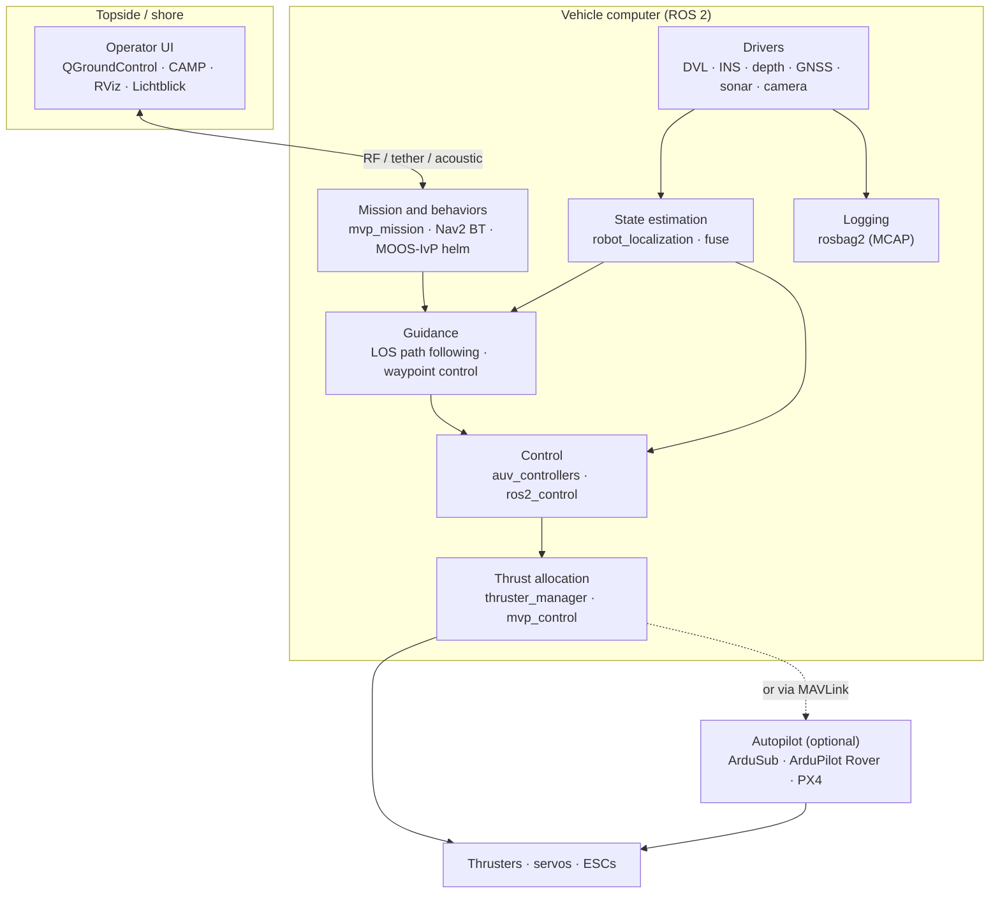

# Software overview

This section is the core of the site. It maps the open-source software that ROS developers use on marine vehicles, says which projects are maintained, and records the conventions and pitfalls that differ from land robotics.

<!-- catalog:stats -->

## Find what you need

-   :material-view-grid-outline:{ .lg } **[Package catalog](catalog.md)**

    Search and filter every tracked project in one view.

-   :material-robot-outline:{ .lg } **[Autonomy frameworks](autonomy_stacks.md)**

    Full stacks such as Blue, Project11, MVP, Orca, and SMaRC 2, plus non-ROS suites (MOOS-IvP, DUNE).

-   :material-cube-scan:{ .lg } **[Simulation](simulation.md)**

    Gazebo, Stonefish, Unreal, Unity, and Isaac Sim based simulators, with a selection guide.

-   :material-compass-outline:{ .lg } **[Drivers and interfaces](drivers.md)**

    ROS 2 driver status by sensor vendor, and the marine_msgs message set.

-   :material-axis-arrow:{ .lg } **[Frames and conventions](conventions.md)**

    REP 103 and REP 105 on a vessel, ENU and NED, heading, depth, and time.

-   :material-ship-wheel:{ .lg } **[Control and allocation](control.md)**

    Thrust allocation, station keeping, path following, and known issues.

-   :material-crosshairs-gps:{ .lg } **[Localization and navigation](navigation.md)**

    DVL and INS dead reckoning, acoustic fixes, GNSS, and EKF tuning.

-   :material-radar:{ .lg } **[Perception and mapping](perception.md)**

    Sonar and camera processing, underwater SLAM, and bathymetry.

-   :material-access-point-network:{ .lg } **[Communication](communication.md)**

    Acoustic modems, satellite, and middleware for slow or intermittent links.

-   :material-tools:{ .lg } **[Tools and workflows](tools.md)**

    Logging, visualization, geodesy, CI, and containers.

-   :material-file-code-outline:{ .lg } **[Integration examples](integration_examples.md)**

    Reference architectures, EKF configurations, and launch patterns.

-   :material-lightning-bolt-outline:{ .lg } **[Quick reference](expert_reference.md)**

    One-page cheat sheet for experienced developers.

## The reference software stack

Most ROS 2 marine vehicles use the same layers. The package names are common choices, not requirements.

Two integration styles are common:

=== "ROS 2 does the control"

    ROS 2 nodes compute control and thrust allocation and send commands straight to the ESCs or motor controllers, often through ros2_control. This gives full control over the algorithms. Blue with auv_controllers and MVP work this way.

=== "An autopilot does the control"

    An autopilot (ArduSub, ArduPilot Rover, or PX4) runs the low-level control and the failsafes. ROS 2 sends setpoints through mavros or the autopilot's DDS interface. This is the quick way to automate a BlueROV2 or a BlueBoat. Orca4 and Orca5 work this way.

## How maritime software differs from land robotics

| Topic | On land | At sea | Where to read more |
|---|---|---|---|
| Position | GNSS, lidar, or wheel odometry are available | No GNSS underwater. Dead reckoning from DVL and INS drifts; acoustic fixes are slow and noisy | [Localization](navigation.md) |
| Frames | ENU world, FLU body (REP 103) | Vendors and textbooks use NED and FRD; depth is positive down | [Conventions](conventions.md) |
| Communication | Wi-Fi or LTE at Mb/s | Acoustic links carry tens of bit/s to tens of kbit/s, with seconds of latency | [Communication](communication.md) |
| Actuation | Wheels with direct kinematics | Over-actuated thruster sets, saturation, dead zones, and currents | [Control](control.md) |
| Perception | Cameras and lidar | Turbidity limits cameras; sonar is the main long-range sensor | [Perception](perception.md) |
| Testing | Test on the bench or in the lab | Pool, lake, and sea time is expensive, so most testing happens in simulation | [Simulation](simulation.md) |

## Maintenance at a glance

Activity labels come from repository commit history and refresh every week. Treat them as a starting point, not a quality rating: read the issues, CI status, and release notes before you depend on a package.

Active commit within 12 months
Low activity within 3 years
Dormant older
Archived read-only

